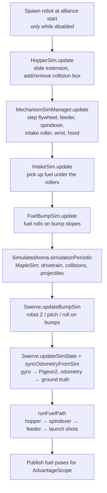
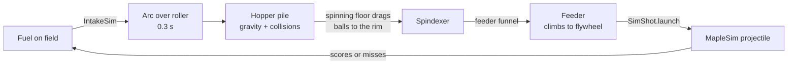

# 2026 Robot — Sim + SOTM

This repo is where we develop the **MapleSim simulation** of the 2026 robot and the
**shoot-on-the-move (SOTM)** fire control. The robot code is the same as the real robot's. The
sim runs underneath it, and AdvantageScope shows a 3D model of the robot with its intake, hood,
hopper, and wheels moving.

This README covers how to set up and run the sim, how SOTM works, and how the sim works inside.
It assumes you already know the rest of the robot code.

---

## Contents

1. [Set up AdvantageScope](#1-set-up-advantagescope)
2. [Run the sim](#2-run-the-sim)
3. [Shoot on the move](#3-shoot-on-the-move)
4. [How the sim works](#4-how-the-sim-works)
5. [Tests](#5-tests)
6. [Updating the 3D model after a CAD change](#6-updating-the-3d-model-after-a-cad-change)
7. [Troubleshooting](#7-troubleshooting)
8. [Credits](#8-credits)

---

## 1. Set up AdvantageScope

The sim runs fine without AdvantageScope, but AdvantageScope is how you actually *see* it. It
shows a 3D model of the robot built from our Onshape CAD, with the intake arm, hood, hopper
extension, and all four swerve wheels driven by the sim.

### Step 1 — Install the robot model (one time)

The 2026 CAD files for this sim are in the **new Powerhouse Google Drive:
02 | Seasons → 2026-2027 → 04 | Programming**. Download the **`Robot_9410_2026`** folder from
there. The model files are too big for git (the chassis alone is about 85 MB), so the repo only
has `config.json`.

Copy the whole `Robot_9410_2026` folder into AdvantageScope's **user assets** folder:

- In AdvantageScope: **Help → Show Assets Folder**, **or**
- On Windows: `%APPDATA%\AdvantageScope\userAssets`

Then **restart AdvantageScope**. The model shows up in the model list as **"9410 2026 Robot"**.

When you're done, the folder should look like this:

```
userAssets/
└── Robot_9410_2026/
    ├── config.json
    ├── model.glb        chassis + everything bolted to it
    ├── model_0.glb      intake arm
    ├── model_1.glb      shooter hood
    ├── model_2.glb      hopper extension
    └── model_3..6.glb   swerve wheels FL, FR, BL, BR
```

### Step 2 — Build the layout

Start the sim ([section 2](#2-run-the-sim)), then in AdvantageScope choose
**File → Connect to Simulator**.

1. Click **+** and add a **3D Field** tab. Pick the 2026 field.
2. Drag **`MapleSim/RobotPose3d`** into **Poses**. Set it to **Robot** and choose
   **9410 2026 Robot** as the model.
   - Use `MapleSim/RobotPose3d`, not `Robot/Pose`. It includes the robot's height and tilt on the
     bumps. `Robot/Pose` works too, but it stays flat.
3. Drag **`Sim/Mechanisms/ComponentPoses`** onto that robot entry as **Component** poses. This
   makes the intake, hood, hopper, and wheels move.
4. Drag **`MapleSim/Fuel3d`** in as **Game Piece**. This shows every fuel ball: on the field, in
   the air, and *inside* the robot (piled in the hopper, riding the spindexer, climbing the
   feeder), so you can see how full the robot is.

Save the layout with **File → Save Layout** so you only have to do this once.

### Optional tabs

| Tab | Add | Shows |
|---|---|---|
| **Mechanism** | `SmartDashboard/Sim/SideView` | 2D side view of the intake arm (orange) and hood (blue) |
| **Line Graph** | `SmartDashboard/Sim/Flywheel/VelocityRps` and `SmartDashboard/shooterVelocity` | Actual vs. requested flywheel speed |
| **2D Field** | `Robot/Pose`, `MapleSim/Fuel2d` | Top-down view |

### Useful keys

These are all under `SmartDashboard/`.

| Key | Meaning |
|---|---|
| `readyToFire`, `headingOK`, `shooterAtSpeed` | Why the robot is or isn't firing |
| `sotmValid`, `sotmConfidence`, `aimDeg`, `headingErrorDeg` | SOTM solver output |
| `distanceToHopper`, `shooterVelocity`, `shooterHoodPos` | Shot target and setpoints |
| `Sim/<Mechanism>/VelocityRps`, `…/AngleDeg`, `…/CurrentAmps` | Simulated mechanism state |
| `Sim/IntakeDeployed`, `simHeldFuelCount`, `simOnBump` | Sim state |

---

## 2. Run the sim

**From VS Code:** `Ctrl+Shift+P` → **WPILib: Simulate Robot Code**.

**From a terminal:**

```bash
./gradlew simulateJava
```

> **Windows:** if Gradle fails with `Type T not present`, your shell is using a newer JDK than
> GradleRIO supports. Set `JAVA_HOME` to WPILib's JDK (`C:\Users\Public\wpilib\2026\jdk`). VS
> Code does this for you.

### Using the Sim GUI

> **Have the FRC Driver Station installed?** Skip this part. Choose **Use Real Driver Station**
> when you launch the sim, then use the DS like normal.

1. Drag your controller from **System Joysticks** onto slot **0** in **Joysticks**.
2. Pick an alliance station in the **FMS** panel.
3. Click **Teleoperated** (or **Autonomous**) under **Robot State**.

Use a real controller. The Sim GUI's keyboard joystick has no right trigger, so you can't shoot
from the keyboard.

### Things the sim does on its own

- **Spawns on your alliance.** While disabled, the robot is moved to your alliance's start spot
  whenever the alliance changes. On blue, that's `(2.0, 4.0)` facing the red wall, and the mirror
  of that on red. It never moves the robot while enabled.
- **Deploys the hopper.** The hopper extension slides out the first time the robot is enabled,
  like the real robot does at the start of a match.
- **Loads the full field.** 360 fuel in the neutral zone, plus both depots.

---

## 3. Shoot on the move

The code for this is in [`frc.firecontrol`](src/main/java/frc/firecontrol) and
`StateMachine.runShootingToTarget()`.

### How a shot is chosen

1. **Solve.** [`ShotCalculator`](src/main/java/frc/firecontrol/ShotCalculator.java) gets the
   robot's pose and field-relative velocity. A shot ball keeps the robot's velocity, so the
   solver aims at a **virtual target**: the real target shifted by robot velocity × time of
   flight. It uses Newton's method to find a flight time that agrees with the shot table, usually
   within 2–3 iterations. It also accounts for latency (30 ms vision + 20 ms mechanism) and for
   the launcher sitting 0.20 m behind the robot's center, facing backward.

   The result is a **flywheel speed**, a **hood angle**, and a **heading to face**. The solver
   returns *invalid* above 3 m/s, or outside 0.5–5 m from the target.
2. **Fall back.** If the solver result is invalid, the robot looks up flywheel speed and hood
   angle by distance from the `ShotConstants` tables and aims straight at the target.
3. **Spin up.** The flywheel and hood go to their setpoints. The hood is clamped to its range.
4. **Aim.** While shoot is held, `SwerveDriveCommand` drives in `AIM` mode. It holds the solver's
   heading, and your translation is cut to 40%. Once the robot is stopped and within 5° of the
   heading, the wheels **park straight** instead of staying in the turn-in-place "X". They unpark
   if the heading drifts past 8°.
5. **Gate.** The feeder and spindexer only run while `readyToFire` is true:
   - `headingOK`: within **15°** of the target heading when the solver is valid, or within **5°**
     when using the fallback or passing
   - `shooterAtSpeed`: actual flywheel speed > requested − 1.5 rps

### Targets

- **In your alliance zone:** your hub (`HOPPER_BLUE` / `HOPPER_RED`).
- **In the other alliance's zone:** 1 m in from the nearer of your two back corners.
- **Passing** (neutral zone or on a bump): a fixed heading (0° on blue, 180° on red) instead of
  the solver's heading.

### The shot table

`SHOOTER_SPEEDS`, `HOOD_ANGLES`, and `SHOOTER_TOF` in
[`ShotConstants`](src/main/java/frc/robot/constants/ShotConstants.java) were **tuned on the real
robot**. They're combined into `SHOT_LUT` and loaded into the solver. The solver uses the time of
flight to lead the target, so if you retune speeds or angles, **keep `SHOOTER_TOF` accurate too**.

[`GenerateLUT`](src/main/java/frc/firecontrol/GenerateLUT.java) and
[`ProjectileSimulator`](src/main/java/frc/firecontrol/ProjectileSimulator.java) are a one-time
tool that can generate a starting table from physics (RK4 with drag and Magnus lift). To use it,
run `GenerateLUT.main` and paste the printed arrays in. Nothing calls it at runtime.

### Tuning knobs

| Where | What |
|---|---|
| `StateMachine()` constructor → `ShotCalculator.Config` | Launcher offset, max SOTM speed, scoring distance range |
| `ShotCalculator.Config` defaults | Latency (`phaseDelayMs`, `mechLatencyMs`), drag, Newton solver limits |
| `runShootingToTarget()` | Heading tolerances (15° / 5°), at-speed margin (1.5 rps), feeder/spindexer speeds while firing |
| `SwerveDriveCommand` | `SLOW_DRIVE_SPEED` (40%), `AIM_PARK_DEG` (5°), `AIM_RELEASE_DEG` (8°) |

---

## 4. How the sim works

The main rule: **the robot code doesn't know it's being simulated.** The subsystems send normal
Phoenix 6 requests. Every loop, the sim:

1. reads the voltage each simulated TalonFX is applying,
2. runs it through a physics model,
3. writes the resulting position and velocity back into the TalonFX/CANcoder sim state.

Because of this, PID, MotionMagic, the at-speed check, and the SOTM gate all behave like they do
on the real robot. That includes being slow, overshooting, and missing a shot because the flywheel
hasn't spun up yet.

All sim code is in [`src/main/java/frc/robot/sim/`](src/main/java/frc/robot/sim). None of it runs
on the real robot: it's all created in `Robot.simulationInit()`, and `Swerve` only builds its
MapleSim model when `Utils.isSimulation()` is true. The physical numbers are in
[`MechanismSimConstants`](src/main/java/frc/robot/sim/MechanismSimConstants.java).

**Robot frame** (used everywhere in the sim): +X is forward (the intake side), +Y is left, +Z is
up, and the origin is the robot's center on the floor. The shooter faces −X.

### The sim loop

`Robot.simulationPeriodic()` runs every 20 ms. The order matters:



- Mechanisms step **before** the intake check, so "is the arm down?" uses this loop's angle.
- The bump sim runs **after** MapleSim and **before** odometry sync, so the CTRE pose includes
  the bump correction.

### The field

`Robot()` replaces MapleSim's arena with `new Arena2026Rebuilt(false)` before `RobotContainer` is
built. The `false` turns off MapleSim's bump colliders so robots can drive over the bumps (our own
bump sims handle them instead). `setEfficiencyMode(false)` loads the full match's worth of fuel.

### Drivetrain — MapleSim ↔ Phoenix 6

`Swerve.initMapleSim()` builds a MapleSim `SwerveDriveSimulation`: 55 kg, 30"×28" bumpers, Kraken
X60s, 5.4:1 drive / 12.1:1 steer, 2" Colsons, and a Pigeon 2. It connects each module to the CTRE
devices through [`PhoenixSimUtil`](src/main/java/frc/robot/sim/PhoenixSimUtil.java):

- On every MapleSim sub-tick, the adapter writes the simulated rotor and encoder values into the
  TalonFX/CANcoder sim states. It then returns the voltage CTRE is commanding, and MapleSim uses
  it to push the wheels.
- `regulateForSimulation()` removes the real encoder offsets and inversions and uses simpler steer
  gains. With the real calibration, the sim robot sits in place and vibrates.
- Each loop, MapleSim's gyro is copied into the Pigeon 2, and CTRE odometry is reset to MapleSim's
  ground-truth pose. Vision is skipped in sim.

### Mechanisms

[`MechanismSimManager`](src/main/java/frc/robot/sim/MechanismSimManager.java) owns six physics
models and steps them once per loop.

#### Rollers — [`RollerMechanismSim`](src/main/java/frc/robot/sim/RollerMechanismSim.java)

These are the flywheel (3× X60), feeder (2× X44), spindexer (1× X60), and intake roller (1× X60).
Each one is a WPILib `DCMotorSim` plus Coulomb friction:

```
TalonFX applied volts − friction (SysId kS) → DCMotorSim → rotor pos/vel → TalonFX sim state
```

- **Inertia is back-calculated from SysId kA** (`J = kA · Kt / (2π · R)`), so it includes belts,
  pulleys, and bearings. The intake roller has no SysId data, so its numbers are estimates.
- Only the leader motor is simulated. Followers are included in the `DCMotor` count.
- Each roller reports its current to MapleSim's battery, so spinning up the flywheel sags the
  battery voltage.

#### Arms — [`ArmMechanismSim`](src/main/java/frc/robot/sim/ArmMechanismSim.java)

These are the intake wrist (2× X44, 44.44:1) and the hood (1× X44). Each one is a WPILib
`SingleJointedArmSim` with gravity and hard stops. The tricky part is converting between three
kinds of units:

| Unit | What it is |
|---|---|
| Physical angle θ | Radians, 0 = forward, + = up. What gravity uses and what gets drawn. |
| Mechanism position P | Rotations. What the code commands (e.g. `INTAKE_MAX = -0.452`). |
| Raw sensor values | What gets written to the CANcoder/TalonFX, after the magnet offset, direction, and gear ratios |

θ and P are tied together by one reference pose taken from CAD. Each loop, the sim goes from
θ → P → raw values using the **same `PositionSubsystemConfig` the real subsystem uses**. That
means changing an offset or ratio in the constants files doesn't break the sim.

Two things that will bite you:
- **The hood CANcoder isn't on the pivot.** It's geared 46:24 off the arm, so one code-rotation is
  24/46 of an arm rotation. The code's hood range of 0.005–0.15 rotations is about 27° of real
  travel, which matches the CAD.
- **The rotor has to move with P, not with the raw CANcoder.** Otherwise the negative
  `SensorToMechanismRatio` makes the PID drive the arm into its hard stop. `MechanismSimTest`
  checks this.

#### Hopper extension — [`HopperSim`](src/main/java/frc/robot/sim/HopperSim.java)

The hopper extension has no motor in code, so it's sim-only. On the first enable, it slides out
over 0.5 s. Once it's more than halfway out, a collision box is added to the MapleSim chassis, so
it hits walls, the hub, and other robots. Fuel is filtered out of that box, because the real
extension sits about 10" up and balls roll under it.

### Fuel: from the floor to the hub



1. **Pickup — [`IntakeSim`](src/main/java/frc/robot/sim/IntakeSim.java).** MapleSim's built-in
   intake grabs any ball that touches the bumper. Ours only takes fuel that's under the rollers
   (15"–28.5" in front of center, ±10" side to side), and only when:
   - the state is `INTAKING`, **and**
   - the arm is actually all the way down (within 0.03 rotations of `INTAKE_MAX`), **and**
   - the roller is spinning faster than 20 rps.

   It takes at most 10 balls/s and holds up to 65. Fuel it can't take yet gets pushed along by
   the bumper.
2. **Inside the robot — [`FuelPathSim`](src/main/java/frc/robot/sim/FuelPathSim.java).** Every
   ball in the robot is simulated:
   - **Hopper:** loose balls with gravity and ball/wall collisions (position-based, 4 substeps per
     loop). Outside the spindexer, the floor is a funnel that rolls balls back onto it.
   - **Spindexer:** balls touching the spinning floor are dragged around with it and pushed out to
     the rim, where the feeder entrance is.
   - **Feeder:** pulls in a ball that's near its entrance and carries it up a path taken from CAD,
     keeping balls one ball-width apart. A ball that reaches the flywheel becomes a shot.

   The spindexer and feeder move at their **simulated** speeds, so the fire rate (about 8 balls/s)
   and the delay before the first shot come from the mechanisms, not a timer.
3. **Launch — [`SimShot`](src/main/java/frc/robot/sim/SimShot.java).** Each ball leaves from
   0.20 m behind center and 0.57 m up, with the robot's velocity added. It uses the **actual**
   simulated flywheel speed and hood angle, not the setpoints, so shooting before they've settled
   misses.

#### How the shot model is calibrated

The launch model isn't a guess at ball physics. It was fit to our real shot table. For each table
row, we solved for the exit speed and angle that reach the 1.83 m hub opening after exactly the
table's time of flight, using MapleSim's gravity. That gives:

```
exit speed (m/s)   = 0.0986 × flywheel rotor rps
launch angle (deg) = 58.81 − 50.37 × hood position (rotations)
```

The fit is within 1.2°, and every row arrives within 0.11 m of the opening height. `SimShotTest`
fires one shot per row and checks that each one scores. **If the shot table changes a lot,
re-fit these numbers** (they're in the "Shots" section of `MechanismSimConstants`). Otherwise the
sim stops matching the real robot.

### Bumps

MapleSim's field is flat, and we turned its bump colliders off, so two classes add the 16.5 cm
bumps back:

- **[`RobotBumpSim`](src/main/java/frc/robot/sim/RobotBumpSim.java)** (adapted from KAISER 6989)
  follows each module over the bump profile to get the robot's height, pitch, and roll. On a
  ramp, it takes over the robot's X motion: below about 1.8 m/s (`√(2gh)`), the robot slides back
  instead of cresting. Crossing at an angle makes the climb easier. The result is published as
  `MapleSim/RobotPose3d`.
- **[`FuelBumpSim`](src/main/java/frc/robot/sim/FuelBumpSim.java)** does the same for fuel. A
  rolling ball on a slope is pulled back by (5/7)·g·sinθ, and it's drawn at the bump's surface
  height.

### How the 3D model moves

`MechanismSimManager.publishTelemetry()` publishes `Sim/Mechanisms/ComponentPoses`, an array of 7
poses. Each one moves a part **relative to where the CAD draws it**:

| Index | Part | Motion |
|---|---|---|
| 0 | Intake arm | Rotates about its pivot by (sim angle − CAD angle) |
| 1 | Hood | Rotates about the flywheel axle by (sim angle − CAD angle) |
| 2 | Hopper extension | Slides back by however far it is from fully out |
| 3–6 | Swerve wheels FL, FR, BL, BR | Spins about the axle by MapleSim's wheel position, then steers from the CAD heading to the module heading |

The order has to match `model_0.glb`–`model_6.glb`. For how the CAD frame maps to the robot frame,
see [`advantagescope/README.md`](advantagescope/README.md).

### Tuning the sim

Every value in `MechanismSimConstants` is labeled with where it came from: **CAD**, **SysId**, or
**ESTIMATE**. If the sim doesn't match the robot, check the `ESTIMATE` values first:

| Constant | Controls |
|---|---|
| `INTAKE_BALLS_PER_SECOND` | How fast the intake swallows fuel |
| `FEEDER_BALL_M_PER_ROTOR_REV` | Fire rate (raise it to shoot faster) |
| `SPINDEXER_REV_PER_ROTOR_REV`, `SPINDEXER_GRIP_PER_SEC`, `SPINDEXER_FLING_MPS2` | How the spindexer moves balls |
| `INTAKE_WRIST_J_KG_M2`, `HOOD_J_KG_M2` | How fast the arms move |
| `INTAKE_ROLLER_J_KG_M2`, `INTAKE_ROLLER_FRICTION_VOLTS` | Intake roller spin-up |
| `HOPPER_DEPLOY_SECS` | Hopper slide time |

---

## 5. Tests

The tests are in [`src/test/java/frc/robot/sim/`](src/test/java/frc/robot/sim):

| Test | Checks |
|---|---|
| `MechanismSimTest` | Builds the **real** subsystems with the sims attached; the intake, hood, and flywheel reach their setpoints. Catches sign and offset mistakes. |
| `SimShotTest` | Every shot table row scores when stationary, and a slow flywheel falls short |
| `FuelPathSimTest` | Fires about 8 balls/s. Nothing fires unless both the spindexer and feeder run. A picked-up ball gets shot. |
| `FieldFuelTest` | Fuel rolls over or back off the bumps correctly. The intake only takes fuel from under the rollers, at its rate limit. |
| `HopperSimTest` | Deploys on enable, hits the wall before the bumper does, and fuel passes under it |
| `RobotBumpSimTest` | A slow robot slides back, a fast robot crosses |
| `ShootingDriveTest` | Holding shoot slows the robot and parks the wheels straight |
| `RobotSimSmokeTest` | Builds the whole `Robot` and runs the sim loop end to end |

```bash
./gradlew test
```

To run one test class:

```bash
./gradlew test --tests frc.robot.sim.MechanismSimTest
```

Each test class gets its own JVM (`forkEvery = 1`), because the HAL, NetworkTables, and the
MapleSim arena are global. Some tests sleep in real time, so the full suite takes a while.

---

## 6. Updating the 3D model after a CAD change

You only need this if the CAD changed. Otherwise, use the folder from the Drive
([section 1](#step-1--install-the-robot-model-one-time)).

1. In Onshape, open **Main Assembly** and choose **Export**, with these settings:
   - Format **GLB**
   - "Y axis up" **unchecked**
   - Resolution **Medium**
   - Compress **off**
2. From the repo root, run this (needs [Node.js](https://nodejs.org/) 18+, no npm install):

   ```bash
   node tools/advantagescope/split-robot-glb.mjs "<path to Main Assembly.glb>" advantagescope/Robot_9410_2026
   ```

3. Copy `advantagescope/Robot_9410_2026` into AdvantageScope's user assets folder and restart
   AdvantageScope. Upload the new folder to the Drive too, so everyone else gets it.
4. The script prints each swerve wheel's center and CAD heading. If they changed, update
   `WHEEL_CENTERS` / `WHEEL_CAD_STEER_RAD` in `MechanismSimConstants`.

**If a part shows up on the wrong component**, add its Onshape instance ID to the lists at the top
of the script (`INTAKE_FIXED_IDS`, `HOOD_IDS`, `HOPPER_IDS`, `SKIP_IDS`). More detail is in
[`advantagescope/README.md`](advantagescope/README.md).

---

## 7. Troubleshooting

| Problem | Fix |
|---|---|
| `Type T not present` when running Gradle | Use the WPILib JDK (`C:\Users\Public\wpilib\2026\jdk`), or build from WPILib VS Code |
| "9410 2026 Robot" isn't in the model list | The `.glb` files aren't in `userAssets/Robot_9410_2026/`, or you didn't restart AdvantageScope |
| The robot shows up, but its parts don't move | Drag `Sim/Mechanisms/ComponentPoses` onto the robot entry as **Component**, not as its own pose |
| Parts are floating or offset | `config.json` and the GLBs come from different exports. Copy the whole folder again. |
| The robot is flat on the bumps | You're using `Robot/Pose`. Use `MapleSim/RobotPose3d`. |
| The robot spawned in the wrong place | Change the alliance **while disabled**. The sim only moves the robot while disabled. |
| The intake won't pick anything up | The arm has to be fully down and the rollers spinning. Give it about half a second, and check `Sim/IntakeDeployed`. |
| Holding shoot, but nothing fires | Check `readyToFire` → `headingOK` / `shooterAtSpeed`. Over 3 m/s the solver returns invalid, and the fallback needs a 5° heading. |
| Sim tests hang | Run one class at a time with `--tests` |

---

## 8. Credits

- **[MapleSim](https://github.com/Shenzhen-Robotics-Alliance/maple-sim)** (Shenzhen Robotics
  Alliance): field, drivetrain, and game piece physics. The MapleSim ↔ Phoenix 6 adapter pattern
  comes from their AKit-MapleSim-Enhanced example.
- **[FRC-Rebuilt-BumpSim](https://github.com/haar09/FRC-Rebuilt-BumpSim)** (KAISER 6989, MIT):
  `RobotBumpSim`, with local changes.
- **FRC Team 5962 perSEVERE** (MIT): `ShotCalculator` and `ProjectileSimulator`.
- **[AdvantageScope](https://github.com/Mechanical-Advantage/AdvantageScope)** (Team 6328).
